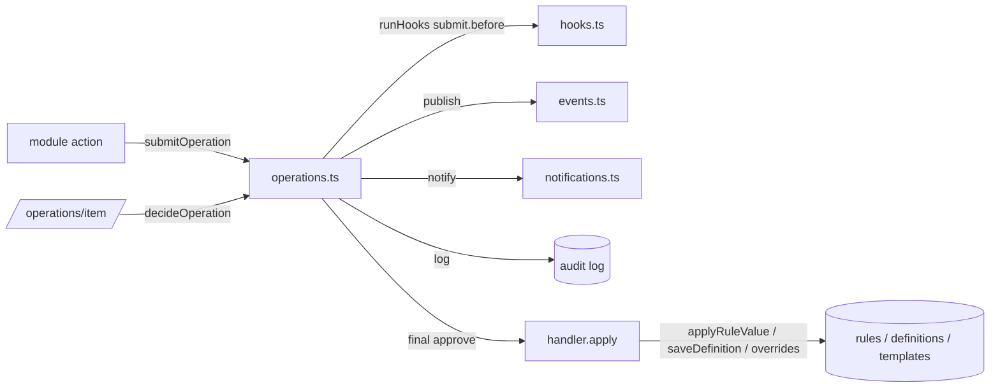

# Operations (platform engine) — implementation

| | |
|---|---|
| Status | Prototype (demo data) — engine complete in the browser; backend parity per ADR-0005 |
| Requirements | [REQUIREMENTS.md](REQUIREMENTS.md) |
| Last updated | 2026-11-12 (feature/fe-gaps) |

## 1. Design overview

Two layers:

1. **Platform engine** (`src/lib/platform/`) — framework-free services with zustand + `localStorage` persistence: operations engine, rules registry, notifications (templates, render, outbox), events (catalogue, publish, subscriptions), hooks (points, handlers, veto/enrich), user scope. `core.ts` registers platform-owned rules, operation types, templates, events and hooks; `registry.ts` imports every module's `platform.ts` once at startup. Each file marks its **BACKEND SEAM**.
2. **Operations UI** (`src/modules/operations/`) — pages composed from `@credigit/web-ui` operations components; `logic.ts` maps engine types to library view models; `platform.ts` registers the area's own rules, `extension.toggle`, templates, events, hooks and two labelled EXAMPLE extensions.

## 2. Files and entry points

| Path | Role |
|---|---|
| `src/lib/platform/operations.ts` | Engine: `registerOperation`, `getDefinition`, `saveDefinition`, `submitOperation`, `decideOperation`, `cancelOperation`, `canDecide`, `canViewOperation`, `actingRoles`, `requiresStepUp`, `stepDueAt`, `instanceSteps`, hooks `useMyApprovalQueue`, `useMyRequests`, `useOperation`, `usePendingFor` |
| `src/lib/platform/core.ts` | Platform rules, `rule.change`, `access.request`, `workflow.change`, `template.change`, `requestRuleChange`, `roleLimit`, core templates / events / hooks |
| `src/lib/platform/rules.ts` | `defineRules`, `getRule`, `useRule`, `validateRuleValue`, `applyRuleValue`, `resetRules`, store `credigit.ser.rules` |
| `src/lib/platform/notifications.ts` | `defineTemplates`, `getTemplate`, `fill`, `renderEmail` (branded, email-safe HTML from live brand tokens), `notify` (role broadcast + one personal notification per addressed user), `notificationVisibleTo`, `isNotificationRead`, `markNotificationsRead`, `useMyNotifications`, store `credigit.ser.notifications` |
| `src/lib/platform/events.ts` | `defineEvents`, `publish`, `subscribe`, `matches` (wildcards), `setSubscriptionEnabled`, store `credigit.ser.events` |
| `src/lib/platform/hooks.ts` | `defineHookPoints`, `registerHook`, `runHooks` (priority order, veto on `.before`, enrich via `ctx`) |
| `src/lib/platform/scope.ts` | `currentActor()` (System actor for background work), `useScope()` |
| `src/lib/platform/registry.ts` | One import per module `platform.ts` |
| `src/modules/operations/platform.ts` | Area rules, `extension.toggle`, templates, events, hooks, EXAMPLE audit mirror + large-exposure guard |
| `src/modules/operations/logic.ts` | Status mapping, timeline, payload facts, rule value ↔ input mapping, 30 s clock, hydration flag |
| `src/modules/operations/*-page.tsx` | approvals, requests, item, workflows, rules, notifications, events pages |

## 3. Routes / endpoints / public API

| Route | Page | Menu entry |
|---|---|---|
| `/operations` | `ApprovalsPage` | Operations → Approvals |
| `/operations/requests` | `RequestsPage` | Operations → My requests |
| `/operations/item?id=OPS-…` | `OperationItemPage` | (record page, linked from queue / notifications / records) |
| `/operations/workflows` | `WorkflowsPage` | Operations → Workflows |
| `/operations/rules?key=…` | `RulesPage` | Operations → Business rules |
| `/operations/notifications` | `NotificationsPage` (templates + outbox) | Operations → Notifications |
| `/operations/events` | `EventsPage` (catalogue, log, hooks, extensions, developer snippet) | Operations → Events & hooks |

Public API for modules: the engine functions listed in §2 (documented in FRONTEND-CONVENTIONS "Platform services").

## 4. Data model

| Store (localStorage key) | Entity | Key fields |
|---|---|---|
| `credigit.ser.operations` | `OperationInstance` | `id`, `operationType`, `definitionVersion`, `title`, `subject {type,id,title,href}`, `payload`, `summary[]`, `amountNgn`, `steps[]` (snapshot), `requestedBy`, `status` (Pending / In progress / Approved / Rejected / Returned / Cancelled / Failed), `stepIndex`, `awaitingAdjudication`, `decisions[]`, `stepStartedAt`, `completedAt`, `reason` |
| same | `definitions` (tenant overrides) | `WorkflowDefinition {operationType, name, module, enabled, version, steps[]}`; `WorkflowStep {id, name, approverRoles[], mode, slaHours, adjudicatorRole?}` |
| `credigit.ser.rules` | `values`, `history[]` | `RuleChange {key, before, after, byId, byName, at, reason, operationId}` |
| `credigit.ser.notifications` | `overrides`, `outbox[]` (≤ 300) | `OutboxItem {templateId, to, subject, html, status}` |
| `credigit.ser.db` (spine) | `Notification` | `roleIds[]` (role broadcast; empty = everyone), `userIds[]` (personal — only these users), `readBy[]` (per-user read state; legacy `read` flag for seed rows) |
| `credigit.ser.events` | `log[]` (≤ 500), `enabled`, `lastRun` | `DomainEvent {name, module, subject, payload, actorId, at, deliveredTo}` |
| in memory | operation handlers, rule / template / event / hook definitions, subscriptions, hook handlers | registered at module load |

## 5. Rule keys used

| Key | Where read |
|---|---|
| `approvals.stepUpThresholdNgn` | `operations.ts` `requiresStepUp`; `item-page.tsx` |
| `operations.minCommentLength`, `operations.commentAlwaysRequired` | `operations.ts` `decideOperation`; item, requests, workflows, events, notifications pages |
| `operations.defaultSlaHours` | `workflows-page.tsx` (new step default) |
| `operations.slaWarningHours` | approvals, requests, item pages |
| `operations.rulesPageSize` | `rules-page.tsx` |
| `operations.testSendRoles` | `notifications-page.tsx` |
| `operations.extensionToggleApproverRoles`, `operations.extensionToggleSlaHours` | `operations/platform.ts` (`toggleSteps`, notify) |
| `operations.example.largeExposurePct`, `platform.shareholdersFundsNgn` | EXAMPLE hook in `operations/platform.ts` |

## 6. Permission keys enforced

| Key | Where checked |
|---|---|
| `rules.rules.request-change`, `operations.workflows.request-change`, `notifications.templates.request-change`, `notifications.templates.test`, `operations.extensions.toggle`, `operations.catalogue.export`, `notifications.outbox.view`, `notifications.outbox.export`, `operations.items.decide`, `operations.items.withdraw`, `operations.oversight.view` | Pages via `useCan(key)` (`@/lib/iam/permissions`); `canDecide` also requires `operations.items.decide` (never bypasses step roles / SoD); `canViewOperation` oversight = `operations.oversight.view` (TD-961 closed). |

## 7. Workflows, notifications, events, hooks wired

| Item (REQUIREMENTS §) | Code location |
|---|---|
| `rule.change`, `workflow.change`, `template.change`, `access.request` (§5) | `src/lib/platform/core.ts` |
| `extension.toggle` (§5) | `src/modules/operations/platform.ts`; submitted from `events-page.tsx` |
| `operations.approval-requested`, `operations.request-completed` (§6) | `operations.ts` `notifyApprovers`, `finalise` |
| `operations.apply-failed` + `operations.request.failed` (OPS-FR-17) | `operations.ts` `finalise` (apply in try/catch; status Approved only after success); template in `core.ts` |
| `operations.request.access-denied` (OPS-FR-16) | `item-page.tsx` (audited + published once per view) |
| `platform.notification.read` (OPS-FR-18) | `notifications.ts` `markNotificationsRead` (bell in `app-frame.tsx`, dashboard inbox) |
| `operations.sla-overdue` + `operations.sla.breached` (§6, §7) | `item-page.tsx` `useEffect` (only when an eligible approver opens an overdue item) |
| `rules.changed`, `operations.workflow-changed`, `operations.template-changed` | `core.ts` operation `apply` |
| `operations.extension-toggled` | `operations/platform.ts` `apply` |
| `operations.request.*`, `operations.step.*` events | `operations.ts` |
| `operations.template.tested` + hook `operations.template.test.before` | `notifications-page.tsx` |
| hook `operations.extension.toggle.before` | `events-page.tsx` |
| hooks `operations.submit.*`, `operations.decide.*` | `operations.ts` |
| `platform.notification.sent` | `notifications.ts` `notify` |

## 8. Tests

| Test file / suite | Covers |
|---|---|
| `e2e/platform/rule-change.spec.ts` | CRO requests rule change → Head of Risk → System Admin → applied, history, bell, HTML email (OPS-FR-11, 12) |
| `e2e/platform/operations-config.spec.ts` | Workflow change approved → new version; template test + wording change; extension disable via approval (FR-10, 12, 13) |
| `e2e/credit/approval.spec.ts` | Co-signer dissent → CCO adjudicates → next tier, step-up, SoD (FR-03, 04, 05) |
| `e2e/platform/rbac.spec.ts` | Operations view-only for Account Officer, direct URLs gated |
| `e2e/risk/pages-load.spec.ts` | Every nav page loads per role |
| `e2e/platform/operations-scope.spec.ts` | Item page hidden from an unrelated role, visible to requester / approver / oversight (FR-16); personal notification only reaches the addressee (FR-18); apply failure → Failed, not Approved (FR-17) |
| Unit tests | None (vitest configured, no test files) |

## 9. Requirements traceability

| FR id | Implemented in | Test | Status |
|---|---|---|---|
| OPS-FR-01 | `operations.ts` `registerOperation`, `getDefinition` | operations-config | Done |
| OPS-FR-02 | `submitOperation` | rule-change | Done |
| OPS-FR-03 | `canDecide` | approval | Done |
| OPS-FR-04 | `decideOperation` (all / adjudicator) | approval | Done |
| OPS-FR-05 | `requiresStepUp`, item-page step-up modal | approval | Partial (UI flag only, no real OTP) |
| OPS-FR-06 | `decideOperation` comment check | — | Done |
| OPS-FR-07 | `decideOperation`, `cancelOperation` | approval | Done |
| OPS-FR-08 | approvals / requests / item pages | rule-change | Done |
| OPS-FR-09 | `item-page.tsx` effect | — | Partial (no sweep; fires only on view) |
| OPS-FR-10 | `workflow.change`, step snapshot | operations-config | Done (timeline and item page read `instanceSteps`) |
| OPS-FR-11 | `rules.ts`, `rule.change`, rules page | rule-change | Done |
| OPS-FR-12 | `notifications.ts`, `template.change`, notifications page | operations-config | Partial (email not sent) |
| OPS-FR-13 | `events.ts`, `hooks.ts`, events page, `extension.toggle` | operations-config | Done |
| OPS-FR-14 | `audit()` in `operations.ts`, `notify` log | rule-change | Partial (final status audited with before / after status; no full instance snapshot, no "where") |
| OPS-FR-15 | — | — | Missing (TD-963) |
| OPS-FR-16 | `canViewOperation`, `item-page.tsx` guard | operations-scope | Done |
| OPS-FR-17 | `finalise` | operations-scope | Done |
| OPS-FR-18 | `notify`, `notificationVisibleTo`, `markNotificationsRead` | operations-scope, rule-change | Done |
| OPS-FR-19 | `timelineSteps(instance)`, item page `highValue` | approval | Done |

## 10. Gaps against the invariants

- **Inv 12:** no named permission keys; actions gated by `useCan("operations", "edit")` (CRO, Head of Risk, System Admin) — System Admin is not granted every permission; PRD §10.4 says configuration is "editable only by the System Admin" (W1).
- **Inv 9 notified / workflow (TD-962):** no SLA sweep — overdue steps escalate only when an eligible approver opens the item; no escalation roles beyond the acting roles (backend ADR-0009 has a job + `operations.slaEscalationRoles`).
- **Inv 8 (TD-966):** literals — default step approvers and SLA hours of `rule.change` (24/24 h), `workflow.change` / `template.change` / `access.request` (48 h) in `core.ts` (TD-127 records the same pattern only for ifrs9 / market-risk); notification recipient roles in `rule.change`, `workflow.change`, `template.change` `apply`; `LOG_LIMIT` 500, `OUTBOX_LIMIT` 300; 30 s UI clock.
- **Step-up:** verification is a client flag (TD-858 pattern).
- **Inv 9 audited:** engine audit entries have no before/after state of the instance and no device / IP ("where").
- **Inv 9 externally reachable (TD-963):** events and hooks are in-browser only — no outbound webhook / message publisher and no inbound APIs; subscriptions are not persisted.
- **Inv 9 connector-ready:** connector points are recorded in [`docs/integration-points.md`](../../integration-points.md); there is no Connectors framework yet (TD-967).
- **TD-128:** module-owned rules can bypass module workflows through generic `rule.change`.
- **Tests:** no unit tests of the engine state machine (backend has `OperationInstanceTests`).

## 11. Tech debt

| TD id | Summary |
|---|---|
| TD-127 | Workflow step SLA hours are literals in registered default definitions (ifrs9, market-risk; "same pattern as core.ts") |
| TD-128 | RAS / ICAAP rules changeable one key at a time through `rule.change`, bypassing module workflows |
| TD-113 | Credit approvals registered as one type per route length (engine reads steps per type; backend ADR-0011 fixes with per-instance routes) |
| TD-804 / TD-110 | Chart-flow shown read-only from static `chartFlow` in admin rules view |
| TD-960 | Closed — library `failed` status mapped |
| TD-961 | Closed — oversight by `operations.oversight.view` |
| TD-962 | No SLA sweep scheduler |
| TD-963 | Events / hooks in-browser only — no outbound webhooks or inbound APIs |
| TD-966 | Core operation default approvers / SLAs / recipient roles are literals |
